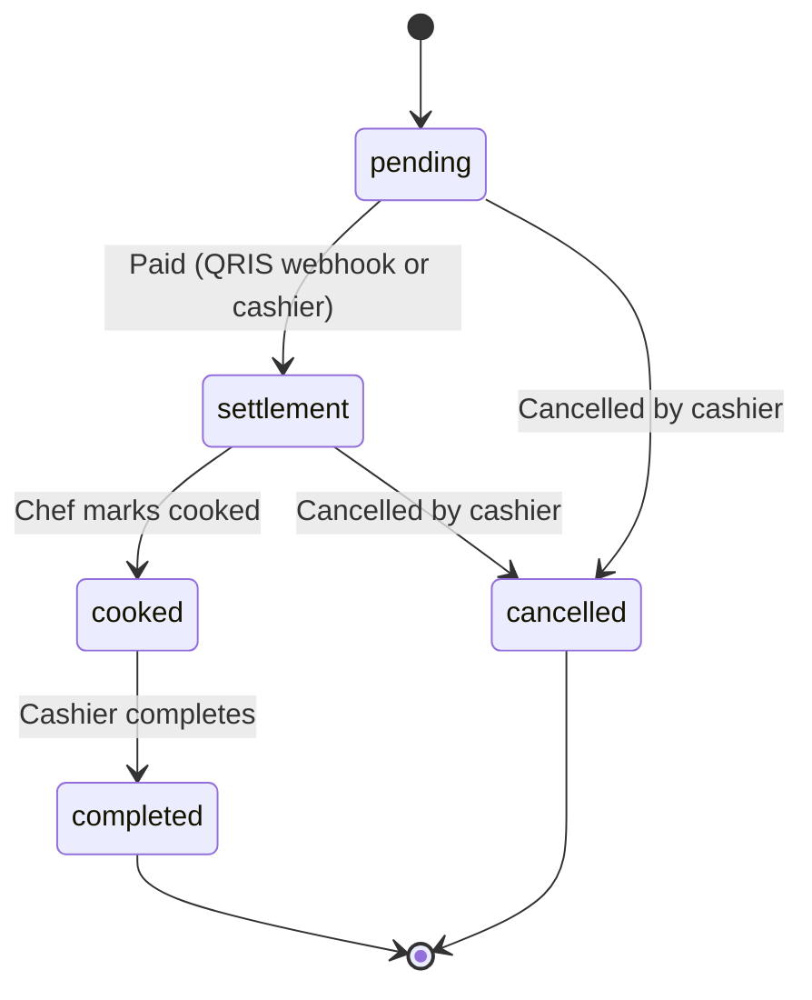

# Orenjoy — QR Code Restaurant Ordering

Customers scan a QR code on their table, order from their phone, and pay online with QRIS. Cashiers and kitchen staff manage orders in real time from role-based panels. No customer account needed.

> **Ringkasan (ID):** Sistem pemesanan restoran berbasis QR code. Pelanggan memindai QR di meja, memesan dari HP, dan membayar dengan QRIS (Midtrans). Kasir, koki, dan admin punya panel masing-masing.


**Live demo:** https://orenjoy.web.id** (no real money)

<p align="center">
  
</p>

---

## Try the demo

| Role    | Username | Password   | What to look at                                           |
| ------- | -------- | ---------- | --------------------------------------------------------- |
| Admin   | `admin`  | `password` | Dashboard, sales report, menu, tables and QR codes, staff |
| Cashier | `kasir`  | `password` | Order queue, create orders for walk-in customers          |
| Chef    | `koki`   | `password` | Kitchen queue                                             |

**Customer flow**

1. Open a table link (`/meja/<table-token>`) to simulate scanning a table's QR code.
2. Add items to the cart and check out with **QRIS**.
3. In the Midtrans popup, pay using the [Midtrans payment simulator](https://simulator.sandbox.midtrans.com/v2/qris/index) (PIN `123456`).
4. Your order page updates by itself, and the order appears in the kitchen queue.

> Payments are simulated with Midtrans Sandbox. The demo data resets automatically.

## Features

**Customer (no login)**

- Scan a table QR code to start ordering; the table is bound to the phone's session
- Menu by category, cart saved in the browser, order notes
- Pay with cash (at the cashier) or QRIS (Midtrans Snap)
- Live order status page, plus "my active orders" so a closed tab never loses an order

**Cashier**

- Order queue with status actions
- Create orders for customers without a phone (dine-in or takeaway), with menu search
- Occupied-table hints to avoid seating two parties at one table
- Confirm cash payments

**Kitchen**

- Queue of paid orders, mark as cooked

**Admin**

- Dashboard with sales summary and a 7-day chart
- Sales report with date range, top-selling items, and CSV export
- Menu and category management with image upload
- Table management, printable QR codes, per-table token regeneration
- Staff management with roles (admin, cashier, chef)

## Screenshots

**Customer (mobile)**

|                                 Menu                                  |                              QRIS payment                               |                                 Order status                                 |
| :-------------------------------------------------------------------: | :---------------------------------------------------------------------: | :--------------------------------------------------------------------------: |
|  |  |  |

**Staff panels (desktop)**

<p align="center">
  
</p>
<p align="center">
  
</p>
<p align="center">
  
</p>

## Order lifecycle



## Technical highlights

- **Server-side pricing.** The browser only sends menu IDs and quantities. Names, prices, and tax are always read from the database by a single `OrderService` shared by the customer and cashier flows.
- **Table binding through the session.** A random 24-character token in each QR code is validated server-side. The table number is never taken from user input, and the binding expires after a configurable time.
- **Midtrans Snap with a verified webhook.** Notifications are authenticated with the SHA-512 signature, then re-verified by calling the Get Status API. Applying a payment is idempotent, so retried or late notifications are harmless.
- **Polling as a fallback.** The order page checks payment status every few seconds, throttled per payment, so a delayed webhook does not leave the customer waiting.
- **Expiry, cancellation, and late payments.** Expired payments can be regenerated with a unique order ID per attempt. Cancelling an order closes the pending payment at Midtrans (with an expire call as fallback), and a payment that arrives after cancellation is logged for manual refund instead of being silently ignored.
- **Concurrency safety.** Order status changes use row locking inside a transaction and a role-aware state machine, so two staff members pressing buttons at once cannot corrupt an order.
- **Role-based access.** Middleware-based roles, with a sidebar generated from the user's role.
- **Safer CSV export.** UTF-8 BOM for Excel, semicolon delimiter, and protection against CSV formula injection.
- **Throttling** on public endpoints (checkout, payment status, login).

## Tech stack

- **Backend:** Laravel 12, PHP 8.2+, MySQL, Eloquent (soft deletes), service layer
- **Payments:** Midtrans Snap (QRIS) through Laravel's HTTP client, no SDK
- **Frontend:** Blade, the Bootstrap-based [Mazer](https://github.com/zuramai/mazer) admin template, vanilla JavaScript
- **QR codes:** `bacon/bacon-qr-code` (SVG)

## Run it locally

Requirements: PHP 8.2+, Composer, MySQL.

```bash
git clone https://github.com/muhamadandy/orenjoy.git
cd orenjoy
composer install
cp .env.example .env
php artisan key:generate
```

Create a MySQL database, set the `DB_*` values in `.env`, then run:

```bash
php artisan migrate --seed
php artisan storage:link
php artisan serve
```

To include sample orders (for the dashboard and reports), set `ORENJOY_DEMO=true` before seeding. The seeder creates 3 staff accounts, 3 categories, 14 menu items, 10 tables and, in demo mode, about two weeks of sample orders.

### Configuration

| Variable                                     | Purpose                                                                                                |
| -------------------------------------------- | ------------------------------------------------------------------------------------------------------ |
| `ORENJOY_TAX_PERCENT`                        | Tax applied per order line                                                                             |
| `ORENJOY_TABLE_SESSION_HOURS`                | How long a scanned table stays bound to a phone                                                        |
| `ORENJOY_TABLE_OCCUPIED_MINUTES`             | Window used for occupied-table hints                                                                   |
| `ORENJOY_DEMO`                               | Demo mode: sample orders and the `demo:reset` command                                                  |
| `MIDTRANS_SERVER_KEY`, `MIDTRANS_CLIENT_KEY` | Midtrans credentials. Leave them empty to disable online payment (QRIS then falls back to the cashier) |
| `MIDTRANS_IS_PRODUCTION`                     | `false` for sandbox                                                                                    |
| `MIDTRANS_ENABLED_PAYMENTS`                  | Payment channels shown in Snap, comma-separated                                                        |
| `MIDTRANS_EXPIRY_MINUTES`                    | Payment expiry in minutes                                                                              |

### Testing Midtrans webhooks locally

Midtrans must be able to reach your machine, so expose it with a tunnel (for example Cloudflare Tunnel or ngrok) and set the **Payment Notification URL** in the Midtrans sandbox dashboard to:

```
https://<your-public-url>/midtrans/notification
```

### Demo reset

```bash
php artisan demo:reset --force
```

It refuses to run unless `ORENJOY_DEMO=true`, and refuses when `MIDTRANS_IS_PRODUCTION=true`.

## Testing and known limitations

- There is no automated test suite yet. Behavior was verified manually end to end, including Midtrans sandbox payments, webhook delivery, payment expiry, and cancellation.
- The demo runs in Midtrans sandbox. In my sandbox account, QR codes issued through the GoPay channel were rejected by Midtrans' simulator, so the demo uses the ShopeePay channel. Available channels and fees must be confirmed per Midtrans account before going live.
- Ideas for later: sound notification for the kitchen, a "mark table as free" action, duplicate-order warning, restoring deleted staff accounts.

## Author

**Muhamad Andy** · [GitHub](https://github.com/muhamadandy)

## License and credits

Code: MIT, see [LICENSE](LICENSE).

The admin panel is built on [Mazer](https://github.com/zuramai/mazer) by Ahmad Saugi (MIT License). See [THIRD_PARTY_NOTICES.md](THIRD_PARTY_NOTICES.md).
