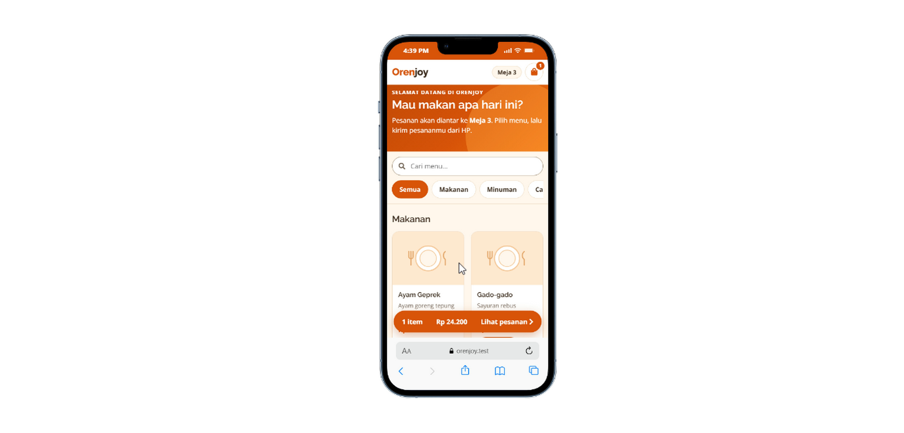
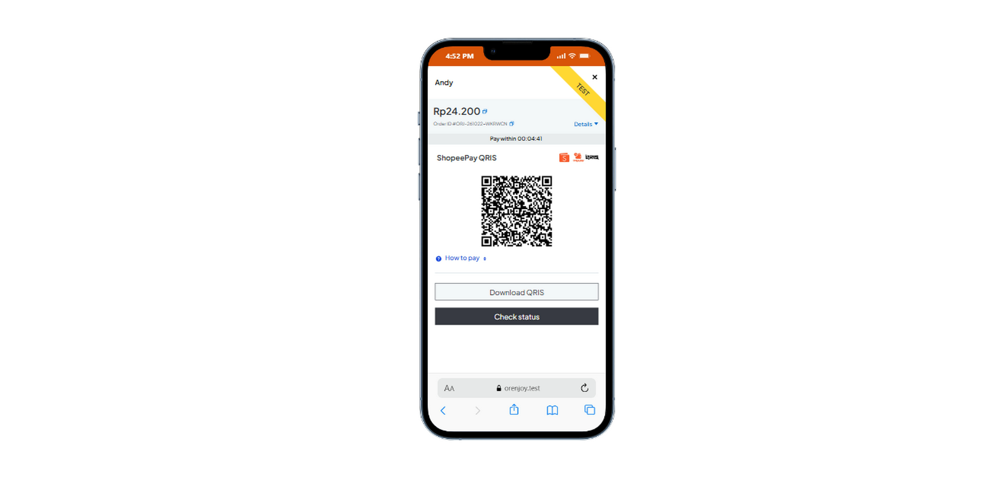
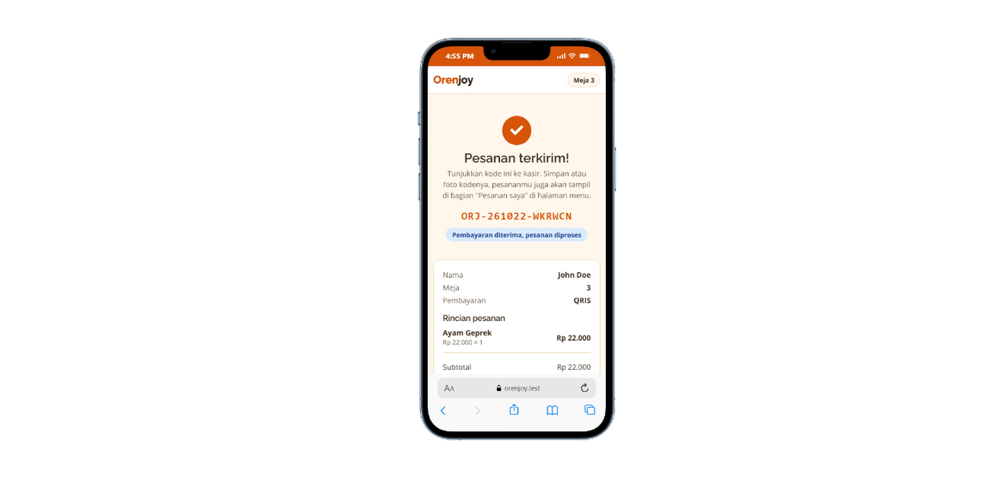
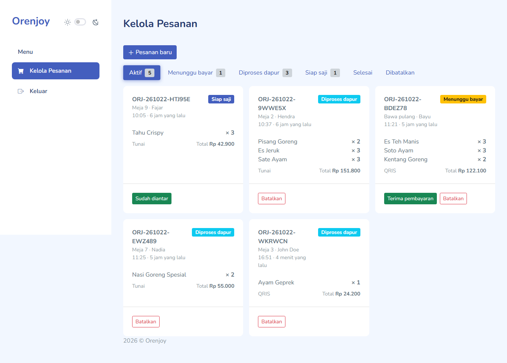
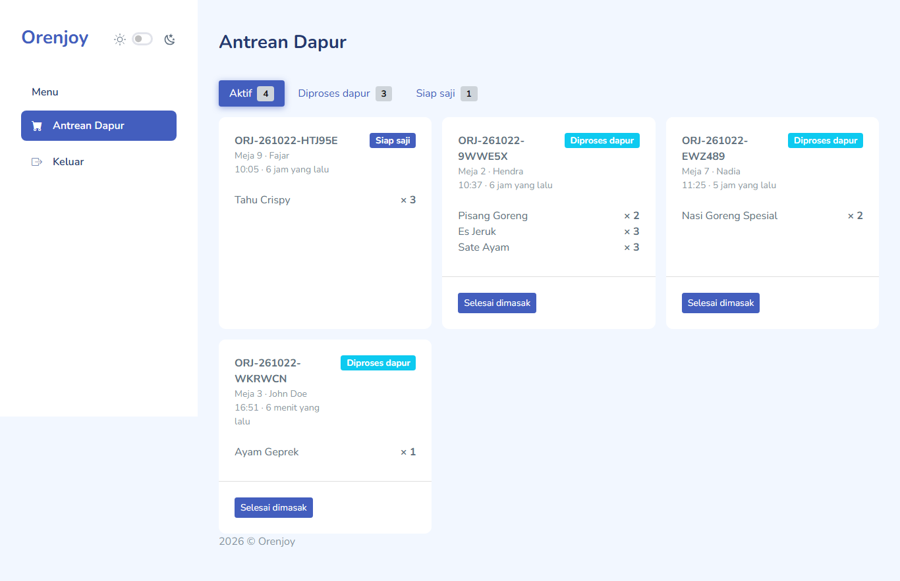
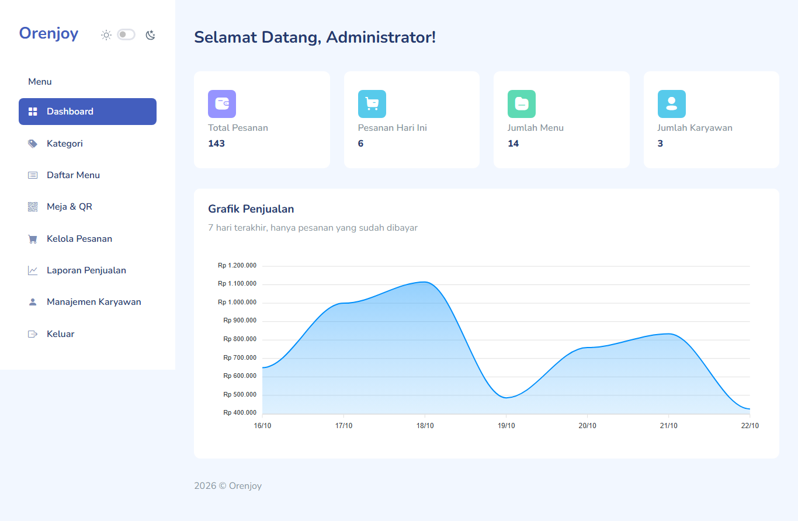
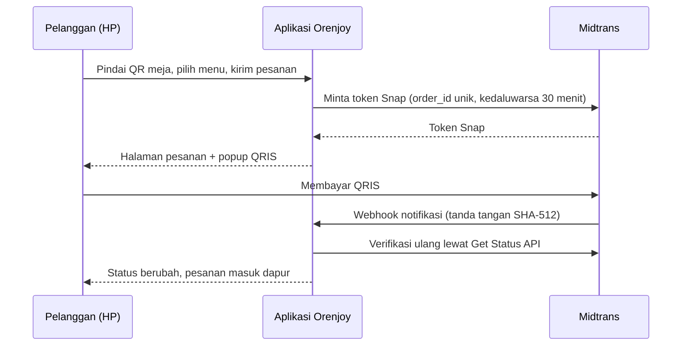

# Orenjoy

**Pemesanan makanan lewat QR code di meja, dengan pembayaran QRIS (Midtrans) dan dapur yang langsung menerima pesanan.**


Pelanggan memindai QR code di meja, memilih menu, lalu membayar dengan tunai di kasir atau QRIS. Begitu pembayaran terkonfirmasi, pesanan otomatis masuk ke layar dapur. Kasir dan admin mengelola pesanan, menu, meja, staf, dan laporan dari satu panel.

Ini proyek portofolio. Seluruh pembayaran di demo berjalan di **mode sandbox Midtrans**, jadi tidak ada uang sungguhan yang terlibat.

---

## Coba demo

| | |
|---|---|
| **Pesan sebagai pelanggan (Meja 1)** | https://orenjoy.web.id/meja/orenjoydemomeja000000001 |
| Lihat daftar menu saja | https://orenjoy.web.id/menu |
| Login staf | https://orenjoy.web.id/admin/login |

> Memesan hanya bisa lewat tautan meja, sama seperti di restoran sungguhan (pelanggan harus memindai QR di meja). Tautan di atas adalah isi QR untuk Meja 1. Meja 2 sampai 10 memakai pola yang sama dengan angka terakhir `000000002` sampai `000000010`.

### Akun demo

| Peran | Username | Password | Yang bisa dilakukan |
|---|---|---|---|
| Admin | `admin` | `password` | Semua fitur: dashboard, menu, meja, staf, laporan |
| Kasir | `kasir` | `password` | Lihat dan ubah status pesanan, input pesanan di kasir |
| Koki | `koki` | `password` | Lihat pesanan masuk dan ubah status di dapur |

### Cara mencoba alur pembayaran QRIS (sekitar 2 menit)

1. Buka tautan Meja 1 di atas, tambahkan beberapa menu, isi nama, pilih **QRIS**, lalu **Kirim Pesanan**.
2. Popup pembayaran Midtrans muncul dengan QR code. Klik kanan gambar QR, lalu **Salin alamat gambar** (di HP: tekan lama pada gambar).
3. Buka simulator QRIS Midtrans Sandbox (panduannya ada di [dokumentasi Midtrans](https://docs.midtrans.com/docs/testing-payment-on-sandbox)), tempel alamat gambar tadi, lalu jalankan pembayaran. Jika diminta PIN, gunakan `123456`.
4. Kembali ke halaman pesanan. Statusnya berubah otomatis menjadi **diproses di dapur**, tanpa perlu memuat ulang halaman.
5. Buka login staf di perangkat lain atau tab baru, masuk sebagai `koki`, dan pesanan tadi sudah muncul di layar dapur.

> **Catatan sandbox:** simulator QRIS Midtrans hanya menerima QR dari acquirer yang tersedia di sandbox. Demo ini memakai ShopeePay sebagai acquirer, jadi QR yang muncul di popup adalah QRIS ShopeePay. QRIS yang dicetak GoPay tidak dikenali simulator sandbox.

Kalau ingin mencoba pembayaran tunai, pilih **Tunai**. Pesanan masuk ke kasir, lalu login sebagai `kasir` dan ubah statusnya untuk meneruskannya ke dapur.

---

## Tampilan

**Sisi pelanggan (di HP)**

| Menu | Pembayaran QRIS | Status pesanan |
|:---:|:---:|:---:|
|  |  |  |

**Sisi staf (di desktop)**







---

## Fitur

**Pelanggan**
- Pemesanan lewat QR code meja. Setiap meja punya token acak sendiri, dan token bisa diganti kalau QR lama bocor.
- Menu per kategori, pencarian, keranjang, dan ringkasan subtotal, pajak 10%, serta total.
- Pembayaran tunai di kasir atau QRIS lewat Midtrans Snap.
- Halaman status pesanan yang memperbarui dirinya sendiri.
- Kalau pembayaran kedaluwarsa, pelanggan bisa membuat pembayaran baru dari halaman yang sama.

**Kasir**
- Melihat semua pesanan dan mengubah statusnya sesuai alur yang diizinkan.
- Menginput pesanan langsung di kasir, dengan pilihan meja atau bawa pulang.

**Koki**
- Layar pesanan untuk memproses dan menyelesaikan pesanan.

**Admin**
- Dashboard ringkasan.
- Kelola kategori dan menu, termasuk menyalakan atau mematikan ketersediaan menu.
- Kelola meja: tambah, nonaktifkan, ganti token, dan cetak QR code.
- Kelola staf beserta perannya.
- Laporan penjualan beserta ekspor.

---

## Alur pembayaran QRIS



Kalau webhook tertunda atau tidak sampai, halaman pesanan memeriksa status ke Midtrans setiap 5 detik sebagai cadangan, jadi pelanggan tidak terjebak di status menunggu.

---

## Hal teknis yang saya kerjakan

- **Webhook yang tidak mudah dipalsukan.** Tanda tangan notifikasi diverifikasi (`SHA512(order_id + status_code + gross_amount + server_key)`), lalu status diverifikasi ulang langsung ke Midtrans. Isi webhook tidak dipercaya begitu saja.
- **Idempoten.** Notifikasi yang sama boleh datang berkali-kali tanpa menggandakan efek. Pembaruan pesanan memakai `lockForUpdate` di dalam transaksi supaya webhook dan pemeriksaan berkala tidak saling menimpa.
- **Cadangan polling.** Webhook bisa gagal, jadi ada pemeriksaan status berkala dengan pembatasan (`Cache::add`) supaya tidak membanjiri API Midtrans.
- **Order ID unik per percobaan bayar** (`ORJ-…`, `-2`, dan seterusnya), sehingga pembayaran yang kedaluwarsa bisa dibuat ulang tanpa bentrok.
- **Pembatalan dan pembayaran terlambat.** Saat pesanan dibatalkan kasir, transaksi di Midtrans ikut ditutup. Kalau pelanggan tetap membayar belakangan, pembayarannya tercatat dan ada peringatan di log supaya bisa ditindak.
- **Arsitektur berlapis.** Logika bisnis ada di service (`OrderService`, `PaymentService`, `MidtransService`), bukan di controller.
- **Hak akses per peran** (admin, kasir, koki) lewat middleware, dengan batas permintaan (throttle) pada rute publik.
- **Mode demo dengan seeder.** Data contoh (menu, meja, riwayat pesanan 14 hari) dibuat dari seeder, dan perintah `demo:reset` mengembalikan semuanya ke kondisi awal. Perintah ini menolak berjalan kalau mode demo mati atau Midtrans dalam mode produksi.

---

## Teknologi

- **Backend:** Laravel 12, PHP 8.2+
- **Database:** MySQL
- **Pembayaran:** Midtrans Snap (QRIS), API Get Status, Cancel, dan Expire
- **Antarmuka:** Blade, template admin [Mazer](https://github.com/zuramai/mazer) (Bootstrap), halaman pelanggan buatan sendiri
- **Hosting demo:** shared hosting cPanel, PHP 8.2

---

## Menjalankan di komputer sendiri

Kebutuhan: PHP 8.2+, Composer, dan MySQL.

```bash
git clone https://github.com/muhamadandy/orenjoy.git
cd orenjoy

composer install
cp .env.example .env
php artisan key:generate
```

Buat database kosong (misalnya `orenjoy`), isi `DB_*` di `.env`, lalu:

```bash
php artisan migrate --seed
php artisan storage:link
php artisan serve
```

Buka `http://localhost:8000/admin/login`. Akun awalnya sama dengan tabel akun demo di atas. Ganti password-nya sebelum dipakai di luar percobaan.

Untuk mengisi riwayat pesanan contoh seperti di demo, jalankan seeder dengan `ORENJOY_DEMO=true` di `.env`.

### Konfigurasi

| Variabel | Fungsi |
|---|---|
| `MIDTRANS_SERVER_KEY`, `MIDTRANS_CLIENT_KEY` | Kunci dari dashboard Midtrans. Keduanya wajib agar QRIS aktif. Jangan pernah di-commit. |
| `MIDTRANS_IS_PRODUCTION` | `false` untuk sandbox, `true` untuk produksi. |
| `MIDTRANS_EXPIRY_MINUTES` | Masa berlaku pembayaran QRIS (bawaan 30 menit). |
| `MIDTRANS_ENABLED_PAYMENTS` | Daftar metode yang ditampilkan di popup Snap, dipisah koma (misalnya `shopeepay`). Kosongkan untuk menampilkan semua. |
| `ORENJOY_DEMO` | `true` untuk mode demo (token meja tetap, riwayat pesanan contoh). Biarkan `false` untuk pemakaian sungguhan. |

Kalau kunci Midtrans kosong, pesanan tetap berjalan dengan pembayaran tunai.

### Menguji webhook di lokal

Midtrans butuh alamat publik untuk mengirim notifikasi. Salah satu caranya memakai Cloudflare Tunnel:

```bash
cloudflared tunnel --url http://orenjoy.test --http-host-header orenjoy.test
```

Salin alamat `https://….trycloudflare.com` yang muncul ke **Payment Notification URL** di dashboard Midtrans Sandbox, dengan tambahan `/midtrans/notification`. Alamat ini berubah setiap tunnel dijalankan ulang.

### Mengembalikan data demo

```bash
php artisan demo:reset --force
```

Perintah ini menghapus seluruh data dan mengisi ulang dari seeder. Ia hanya jalan saat `ORENJOY_DEMO=true` dan `MIDTRANS_IS_PRODUCTION=false`. Di server, jangan pernah memakai `migrate:fresh` pada data sungguhan.

---

## Batasan (apa adanya)

- **Belum ada tes otomatis.** Alur utama saya uji manual, termasuk skenario kedaluwarsa, pembatalan, dan pembayaran terlambat. Tes otomatis untuk `PaymentService` adalah langkah berikutnya.
- **Pembayaran hanya dites di sandbox.** Untuk produksi, merchant perlu disetujui Midtrans, dan metode serta biaya QRIS mengikuti kontrak merchant tersebut.
- **Gambar menu di demo memakai placeholder.** Foto yang diunggah lewat admin tidak ikut di Git.
- **Akun demo memakai password sederhana** dan bersifat publik. Itu sengaja untuk demo, jangan dipakai apa adanya di restoran sungguhan.

---

## Pembuat

**Muhamad Andy** · [github.com/muhamadandy](https://github.com/muhamadandy)

Terbuka untuk kesempatan kerja sebagai web developer (Laravel / PHP).

## Lisensi

Proyek ini berlisensi [MIT](LICENSE). Template admin Mazer dipakai di bawah lisensi MIT miliknya sendiri, lihat [THIRD_PARTY_NOTICES.md](THIRD_PARTY_NOTICES.md).
